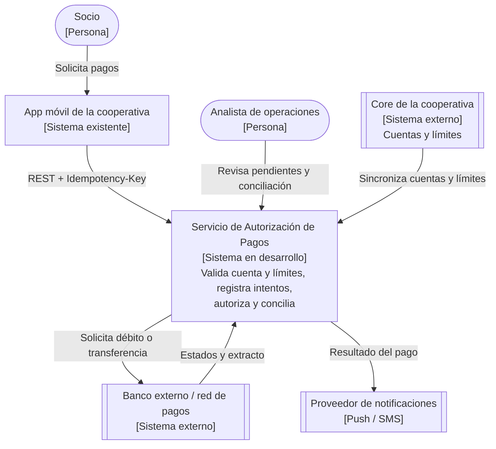
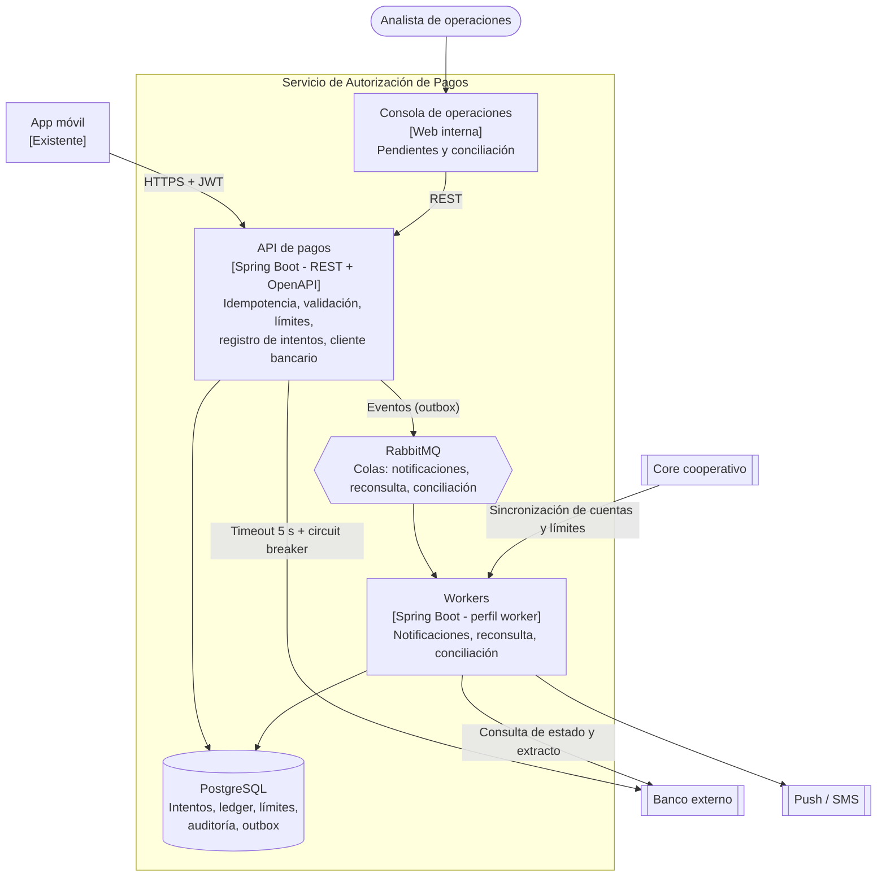
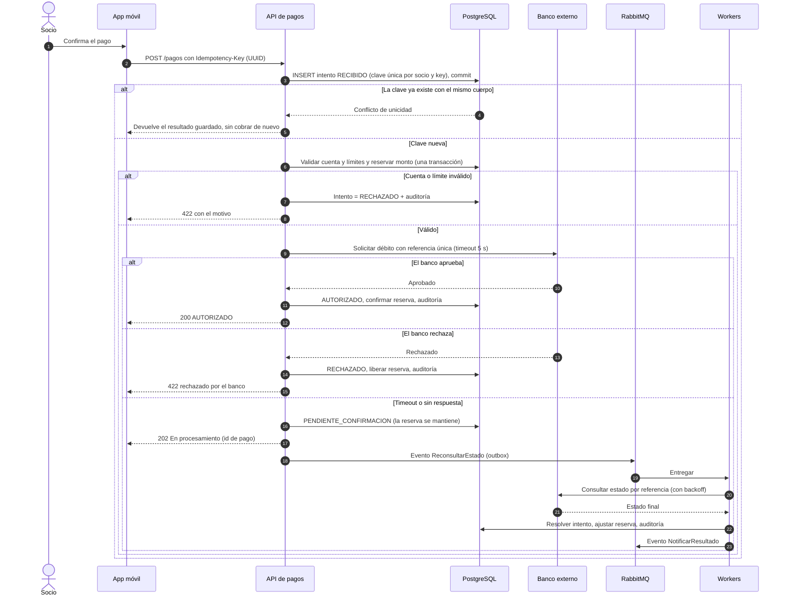

# Ejercicio 2 — Autorización de pagos

> **Diseño de Sistemas** · Taller de arquitectura · Ejercicio 2 de 4

| | |
|---|---|
| **Autor** | TU NOMBRE AQUÍ |
| **Curso** | Diseño de Sistemas |
| **Diagramas** | Mermaid (se visualizan directamente en GitHub) |

## Contenido

- [Decisiones clave del enunciado](#decisiones-clave-del-enunciado)
- [1. Objetivo, actores y alcance](#1-objetivo-actores-y-alcance)
- [2. Requisitos funcionales y de calidad](#2-requisitos-funcionales-y-de-calidad)
- [3. Diagramas C4](#3-diagramas-c4)
- [4. Flujo de una operación crítica: autorizar un pago](#4-flujo-de-una-operación-crítica-autorizar-un-pago)
- [5. Stack propuesto y justificación](#5-stack-propuesto-y-justificación)
- [6. Dos ADR](#6-dos-adr)
- [7. Tres riesgos y cómo reducirlos](#7-tres-riesgos-y-cómo-reducirlos)
- [8. Métricas](#8-métricas)
- [Estructura del repositorio](#estructura-del-repositorio)
- [Verificación de cumplimiento](#verificación-de-cumplimiento)

## Decisiones clave del enunciado

| Pregunta | Decisión | Justificación |
|---|---|---|
| ¿Qué pasos son síncronos? | Registrar el intento → verificar clave de idempotencia → validar cuenta → verificar límites y reservar monto → pedir autorización al banco (con timeout) → responder | Es el camino mínimo para que el socio reciba un resultado fiable. Cuenta y límites residen en la base propia (sincronizados desde el core), así que no dependen de un servicio externo. |
| ¿Qué va en segundo plano? | Notificaciones, **reconsulta de pagos pendientes**, conciliación, reportes contables | Nada de esto cambia la respuesta inmediata y todo tolera segundos o minutos de retraso. |
| ¿Cómo evito cobrar dos veces? | **Idempotency-Key** enviada por la app + restricción `UNIQUE (socio_id, idempotency_key)` en PostgreSQL + hash del cuerpo + **referencia única hacia el banco** | Mismo key y mismo cuerpo → se devuelve el resultado guardado. Mismo key con cuerpo distinto → `422`. Petición original aún en curso → `409`/`202`. Además el banco deduplica por referencia. |
| ¿Qué queda en auditoría? | Quién, qué, cuándo, desde dónde, con qué datos (enmascarados), resultado, tiempos y llamadas al banco (ver tabla en §6) | Permite reconstruir cualquier pago y atender reclamos y auditorías. |
| ¿Y si el banco responde tarde o no responde? | **No se reintenta el débito a ciegas.** Tras 5 s el intento pasa a `PENDIENTE_CONFIRMACION`, se responde `202` con el id del pago y se mantiene la reserva; un worker **consulta el estado por referencia** con *backoff* y la conciliación cierra los casos restantes | Un timeout no significa que el banco no cobró. Reintentar sin confirmar es la causa clásica del doble cobro. |

## 1. Objetivo, actores y alcance

**Objetivo.** Autorizar los pagos de los socios iniciados desde la app móvil: validar la cuenta, verificar límites, registrar **cada intento** (incluso si un servicio externo falla), responder al cliente y conciliar después.

**Actores.**
- **Socio:** inicia pagos desde la app.
- **Analista de operaciones:** revisa pagos pendientes y la conciliación, resuelve excepciones.
- **Banco externo / red de pagos:** ejecuta el débito o la transferencia.
- **Core de la cooperativa:** sistema de registro de cuentas y límites.
- **Proveedor de notificaciones** (push / SMS).
- **Auditor/Cumplimiento:** consulta la bitácora.

**Alcance.**
- *Dentro:* API de autorización, idempotencia, validación de cuenta y límites, cliente bancario, registro de intentos, notificaciones, reconsulta y conciliación, consola de operaciones.
- *Fuera:* la app móvil (existente), el core, la prevención de fraude avanzada, los contracargos.

**Supuestos.** El banco permite enviar una referencia única por operación, consultar estado por esa referencia y entrega un extracto diario. El core sincroniza cuentas y límites periódicamente.

## 2. Requisitos funcionales y de calidad

**Funcionales**
- RF1. Recibir una solicitud de pago con clave de idempotencia.
- RF2. Validar existencia, estado y titularidad de la cuenta.
- RF3. Verificar límites por transacción y acumulados diarios, y reservar el monto de forma atómica.
- RF4. Registrar todo intento (recibido, rechazado, autorizado, pendiente, fallido) antes de llamar a terceros.
- RF5. Solicitar autorización al banco y responder al socio con un estado claro.
- RF6. Consultar el estado de un pago por su id.
- RF7. Reconsultar pagos pendientes y resolverlos; liberar o confirmar reservas.
- RF8. Notificar el resultado al socio.
- RF9. Conciliar diariamente contra el extracto del banco y reportar diferencias.

**Calidad**
- **Exactitud:** cero cobros duplicados; los límites nunca se exceden aunque haya solicitudes concurrentes.
- **Latencia:** p95 de autorización ≤ 3 s extremo a extremo; timeout al banco de 5 s.
- **Disponibilidad:** 99,9 % de la API; una caída del banco no impide registrar intentos ni rechazar los inválidos.
- **Consistencia:** fuerte en límites y estado del intento (PostgreSQL); eventual en notificaciones y conciliación.
- **Seguridad:** TLS, OAuth2/JWT, números de cuenta enmascarados en logs, cifrado en reposo, validación de esquema OpenAPI.
- **Auditabilidad:** bitácora inmutable, identificador de correlación en todas las llamadas.
- **Observabilidad:** métricas y alertas por estado, latencia y tasa de errores del banco.

## 3. Diagramas C4

### 3.1 Nivel 1 — Contexto



### 3.2 Nivel 2 — Contenedores



## 4. Flujo de una operación crítica: autorizar un pago



**Puntos finos.** El intento se confirma (*commit*) **antes** de llamar al banco: así queda registrado aunque todo lo demás falle. Si llega una segunda solicitud con la misma clave mientras la primera sigue en curso, se responde `409`/`202` sin ejecutar nada nuevo. El reintento hacia el banco siempre usa la **misma referencia**.

## 5. Stack propuesto y justificación

| Capa | Elección | Por qué |
|---|---|---|
| Backend | Spring Boot (Java 21) + Resilience4j | Madurez en servicios transaccionales; timeout, circuit breaker y *bulkhead* para aislar al banco. |
| Contrato | REST + **OpenAPI** | Contrato versionado con la app móvil; validación automática de esquemas. |
| Base de datos | PostgreSQL | ACID para intento + reserva + límites; restricción única para idempotencia; auditoría y outbox en el mismo motor. |
| Mensajería | **RabbitMQ** (no Kafka) | El trabajo asíncrono es de tareas con reintento y confirmación (notificar, reconsultar, conciliar), no de flujo masivo de eventos. Kafka se reconsideraría si el volumen exigiera reproducir historial o procesar streams. |
| Idempotencia | Claves en PostgreSQL | Misma transacción que el intento; sin un almacén extra que pueda desincronizarse. |
| Despliegue | Docker | Entornos reproducibles; workers como perfil del mismo artefacto. |

## 6. Dos ADR

Cada ADR también está como archivo individual en [`docs/adr/`](docs/adr/).

**ADR-001 — Registro previo del intento y estado `PENDIENTE_CONFIRMACION` (autorización síncrona corta, cierre asíncrono)** · Estado: Aceptada · Tipo: arquitectónica
- **Contexto:** el banco es un tercero que puede tardar o no responder, y el socio necesita una respuesta rápida sin riesgo de doble cobro.
- **Decisión:** persistir el intento antes de cualquier llamada externa; llamar al banco con timeout de 5 s; si no hay respuesta, responder `202`, conservar la reserva y resolver con consulta de estado y conciliación. Modelo de estados: `RECIBIDO → VALIDADO → AUTORIZADO | RECHAZADO | PENDIENTE_CONFIRMACION → AUTORIZADO | RECHAZADO | REVERSADO`.
- **Alternativas:** esperar al banco sin límite (rechazada: bloquea hilos y la app); confirmación distribuida 2PC (inviable con un banco externo); todo asíncrono (rechazada: peor experiencia para pagos que el banco resuelve en milisegundos).
- **Consecuencias:** (+) cada intento queda trazado, no se cobra dos veces, tolera fallos del banco. (−) el cliente puede ver un estado intermedio; exige reconsulta, conciliación y buena comunicación en la app.

**ADR-002 — Idempotencia con clave única en PostgreSQL (no en una caché)** · Estado: Aceptada · Tipo: tecnológica
- **Contexto:** el cliente móvil reintenta ante redes inestables; un reintento nunca puede cobrar dos veces.
- **Decisión:** la app genera un UUID por intención de pago y lo envía como `Idempotency-Key`. Una restricción `UNIQUE (socio_id, idempotency_key)` más el hash del cuerpo decide si la solicitud es repetida, conflictiva o nueva, dentro de la misma transacción que registra el intento.
- **Alternativas:** `SETNX` en Redis (rechazada: componente adicional, volátil, puede divergir del estado real); confiar solo en la deduplicación del banco (rechazada: no cubre rechazos previos ni límites internos).
- **Consecuencias:** (+) garantía fuerte y simple, sin infraestructura nueva. (−) la tabla de claves crece: se define retención (p. ej. 30 días) y limpieza programada.

**Información mínima de auditoría por intento**

| Grupo | Datos |
|---|---|
| Identidad | socio, cuenta (enmascarada), canal/dispositivo, IP, versión de la app |
| Solicitud | `Idempotency-Key`, hash del cuerpo, monto, moneda, destino, fecha y hora (UTC) |
| Decisiones | resultado de validación de cuenta, límite aplicado y acumulado, regla que rechazó |
| Banco | referencia enviada, hora de envío y de respuesta, código y mensaje del banco, número de reintentos de consulta |
| Estado | cada transición (de → a), quién o qué la provocó (sistema, worker, analista) y motivo |
| Trazabilidad | id de correlación, id de pago, id de conciliación, ajustes manuales con autor |

## 7. Tres riesgos y cómo reducirlos

| Riesgo | Impacto | Mitigación |
|---|---|---|
| **Doble cobro** por reintentos o timeouts ambiguos | Muy alto | Idempotency-Key con restricción única, referencia única hacia el banco, consulta de estado antes de cualquier reintento, pruebas de concurrencia y de caos (cortes de red a mitad del flujo). |
| **Degradación por el banco** (lento o caído) que arrastra a toda la API | Alto | Timeout, circuit breaker y *bulkhead* aislados; estado `PENDIENTE_CONFIRMACION`; los rechazos locales (cuenta o límite) siguen funcionando; alertas por tasa de timeouts. |
| **Diferencias de conciliación** entre el sistema, el core y el banco | Alto | Conciliación diaria automatizada por referencia, cola de excepciones para operaciones, ajustes manuales solo con doble aprobación y registro en la auditoría. |

## 8. Métricas

| Métrica | Tipo | Definición | Meta inicial | Fuente |
|---|---|---|---|---|
| **Pagos duplicados** | **Negocio (principal)** | Pagos con la misma intención cobrados más de una vez | **0** | Conciliación + ledger |
| Tasa de autorización | Negocio | Autorizados ÷ intentos válidos | ≥ 97 % | Tabla de intentos |
| **Latencia de autorización** | **Técnica (principal)** | p95 desde la solicitud hasta la respuesta | ≤ 3 s | Métricas de la API |
| Tasa de errores | Técnica | Respuestas 5xx y timeouts ÷ solicitudes | < 1 % | Métricas + logs |
| Tiempo de conciliación | Operativa | Desde la fecha del pago hasta su cierre conciliado | < 24 h (95 % de casos) | Módulo de conciliación |

## Estructura del repositorio

```text
diseno-sistemas-ej2-autorizacion-pagos/
├── README.md                      <- documento completo del ejercicio
└── docs/
    ├── adr/
    │   ├── adr-001-registro-previo-y-estado-pendiente-confirmacion.md
    │   └── adr-002-idempotencia-con-clave-unica-en-postgresql.md
    └── diagrams/
        ├── c4-nivel1-contexto.mmd
        ├── c4-nivel2-contenedores.mmd
        └── flujo-autorizar-pago.mmd
```

Los archivos `.mmd` contienen el código fuente de cada diagrama; se pueden abrir y editar en <https://mermaid.live>.

## Verificación de cumplimiento

| Entregable solicitado | Dónde está |
|---|---|
| Objetivo, actores y alcance | §1 |
| Requisitos funcionales y de calidad | §2 |
| Diagrama C4 de contexto y contenedores | §3.1 y §3.2 (fuentes en `docs/diagrams/`) |
| Flujo de una operación crítica | §4 |
| Stack propuesto con justificación | §5 |
| Dos ADR (una arquitectónica y una tecnológica) | §6 y `docs/adr/` |
| Tres riesgos y cómo reducirlos | §7 |
| Una métrica de negocio y una técnica | §8 (marcadas como «principal») |
| Decisiones que debes tomar | Tabla «Decisiones clave del enunciado» |
